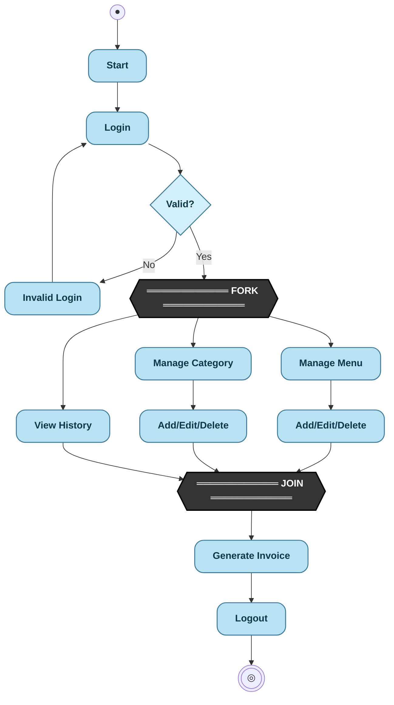
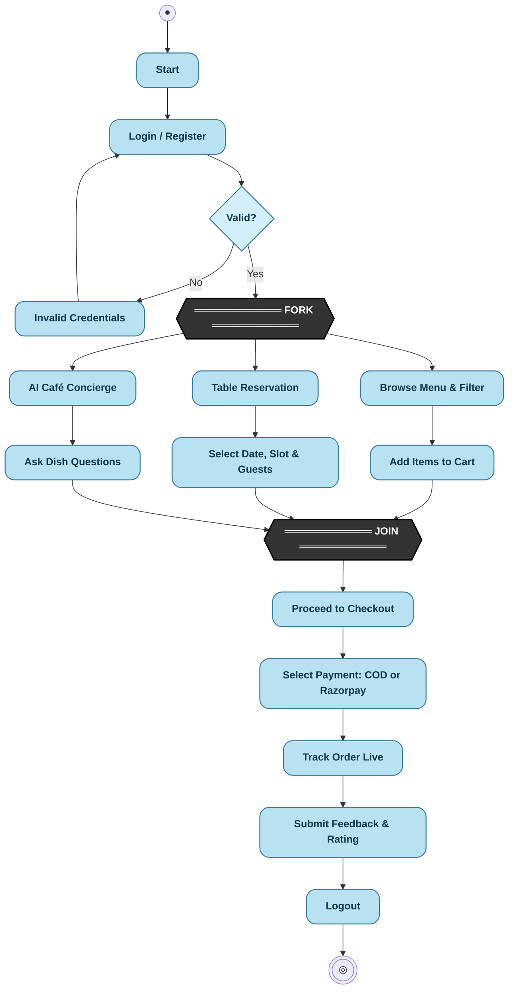
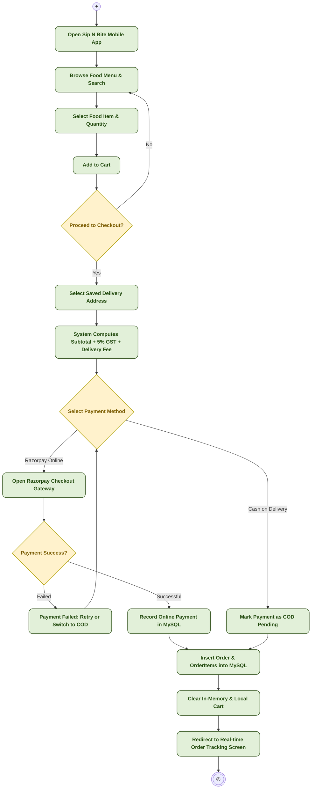
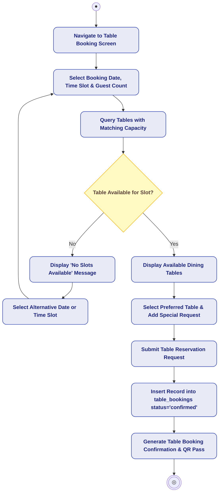
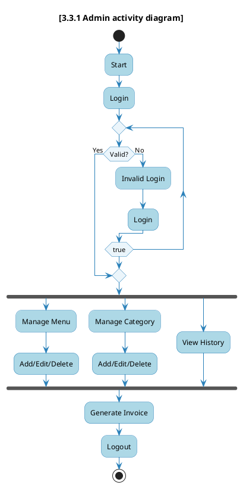
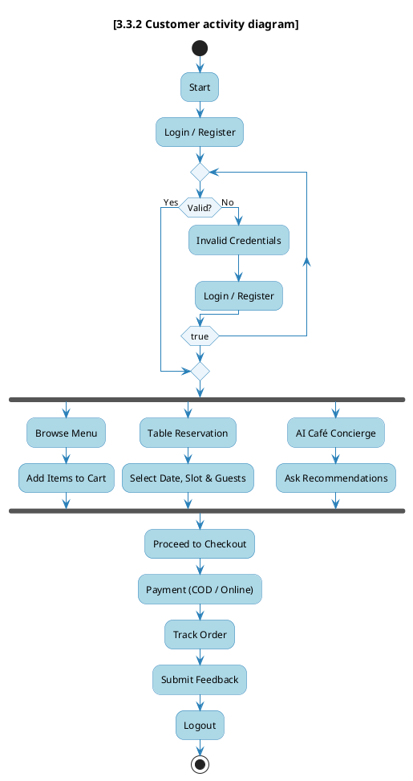
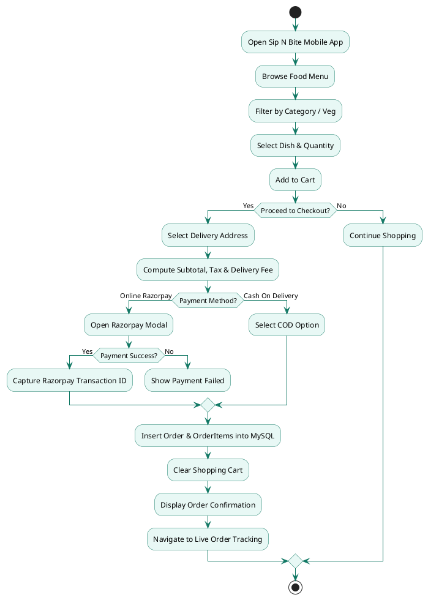

# ⚡ Activity Diagram — Sip N Bite (Web + Android)

> **Project:** Sip N Bite — Smart Café & Food Ordering Platform  
> **Platform Scope:** Web Admin Dashboard (Laravel 11) + Mobile Application (React Native / Android)  
> **Location:** `Documentation/diagrams_file_code/activity_diagram.md`

---

## 1. Executive Summary & Diagram Structure

This document provides dedicated, complete Activity Diagrams for **both Admin and Customer**, formatted to match the exact visual style in the project specification and reference images.

- **Part 1:** **[3.3.1 Admin activity diagram]** *(1:1 exact reproduction of Reference Image 2)*
- **Part 2:** **[3.3.2 Customer activity diagram]** *(Formatted in the exact same style with Fork, Parallel Modules, Join, Checkout & Logout)*
- **Part 3:** **Customer Food Ordering & Payment Sub-Activity Flow** *(Detailed Decision Branches for COD & Razorpay)*
- **Part 4:** **Table Reservation Sub-Activity Flow** *(Slot Availability Verification Flow)*
- **Part 5:** **Complete PlantUML Source Codes** *(Ready for high-res export into project report docs)*

---

## 2. [3.3.1 Admin activity diagram] (Exact Reference Match)

The diagram below exactly reflects the visual structure, fork/join parallelism, and decision loop from the reference image:
- **Initial Node:** `●`
- **Actions:** `Start` ➔ `Login`
- **Decision:** `Valid?`
  - **[No]** ➔ `Invalid Login` ➔ loops back to `Login`
  - **[Yes]** ➔ passes to **FORK Bar**
- **Concurrent Fork Branches:**
  1. `Manage Menu` ➔ `Add/Edit/Delete`
  2. `Manage Category` ➔ `Add/Edit/Delete`
  3. `View History`
- **JOIN Bar:** Synchronizes all parallel management operations
- **Sequential Actions:** `Generate Invoice` ➔ `Logout`
- **Final Node:** `End` (`◎`)

### Mermaid Diagram — Admin Activity

---

## 3. [3.3.2 Customer activity diagram] (Exact Reference Style)

Engineered in the exact same structural pattern as the Admin diagram to cover the customer journey on the **React Native Android mobile app** and **Web customer portal**:
- **Initial Node:** `●`
- **Actions:** `Start` ➔ `Login / Register`
- **Decision:** `Valid?`
  - **[No]** ➔ `Invalid Credentials` ➔ loops back to `Login / Register`
  - **[Yes]** ➔ passes to **FORK Bar**
- **Concurrent Fork Branches:**
  1. `Browse Menu` ➔ `Add Items to Cart`
  2. `Table Booking` ➔ `Select Date / Time Slot`
  3. `AI Café Concierge` ➔ `Ask Recommendations`
- **JOIN Bar:** Synchronizes user activities
- **Sequential Actions:** `Proceed to Checkout` ➔ `Payment (COD / Online)` ➔ `Track Order` ➔ `Submit Feedback` ➔ `Logout`
- **Final Node:** `End` (`◎`)

### Mermaid Diagram — Customer Activity

---

## 4. Customer Food Ordering & Checkout Sub-Activity Flow

Provides deep granularity into the cart calculation, payment branching, and database updates for the food ordering subsystem.

---

## 5. Dining Table Reservation Sub-Activity Flow

Models table slot checking, availability validation, and reservation pass generation.

---

## 6. Activity Execution Step Dictionary (Admin vs. Customer)

| Step # | Admin Activity Path | Customer Activity Path | Technical Operation / Endpoint |
|--------|---------------------|------------------------|--------------------------------|
| **1** | Start & Login | Start & Register / Login | `POST /login` or `POST /api/login` |
| **2** | Validation Loop | Validation Loop | Verification of email/hash in `users` table |
| **3** | Fork: Split into Parallel Modules | Fork: Split into Parallel Modules | Fork bar concurrency |
| **4a**| Manage Menu (Add/Edit/Delete) | Browse Menu & Filter by Category | `GET/POST/PUT /admin/menu-items` vs `GET /api/menu` |
| **4b**| Manage Category (Add/Edit/Delete) | Table Reservation (Pick Date & Guests) | `GET/POST /admin/categories` vs `POST /api/table-bookings` |
| **4c**| View History (Orders & Analytics) | AI Café Concierge (Ask Dish Details) | `GET /admin/orders` vs `POST /api/chatbot/message` |
| **5** | Join: Synchronize Management Tasks | Join: Synchronize Customer Modules | Join bar synchronization |
| **6** | Generate Invoice | Proceed to Checkout & Pay (COD / Razorpay) | PDF generation vs `POST /api/checkout` |
| **7** | Review Customer Feedback | Real-time Order Tracking & Submit Feedback | `GET /admin/feedbacks` vs `POST /api/feedback` |
| **8** | Logout & End | Logout & End | Session termination / Token revocation |

---

## 7. PlantUML Source Code

### 7.1 PlantUML Code — [3.3.1 Admin activity diagram] (Exact Reference Match)

### 7.2 PlantUML Code — [3.3.2 Customer activity diagram] (Exact Reference Style)

### 7.3 PlantUML Code — Detailed Food Ordering & Payment Flow

