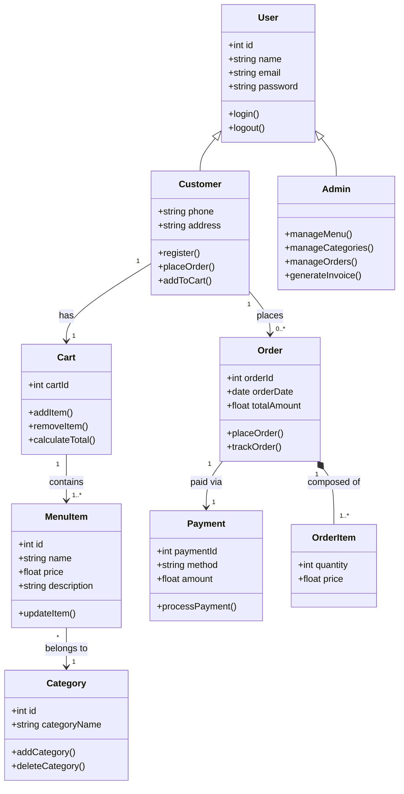
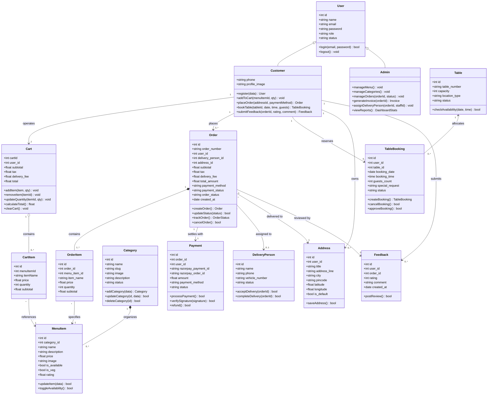
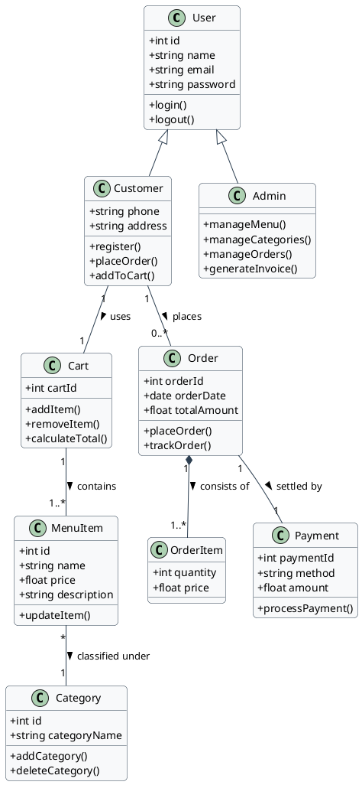

# 🧱 Class Diagram — Sip N Bite (Web + Android)

> **Project:** Sip N Bite — Smart Café & Food Ordering Platform  
> **Platform Scope:** Web Admin Dashboard (Laravel 11) + Mobile Application (React Native / Android) + Database Layer  
> **Location:** `Documentation/diagrams_file_code/class_diagram.md`

---

## 1. Overview & Diagram Catalog

A **Class Diagram** is a static structural diagram that describes the structure of a system by showing the system's classes, their attributes, operations (or methods), and the relationships among objects (inheritance, association, composition, aggregation, and dependency).

This document contains:
1. **[Exact Reference Style] Core Class Diagram** *(Matches user reference image 1:1)*
2. **Comprehensive Full-System Class Diagram** *(Includes Sip N Bite tables: Table, TableBooking, DeliveryPerson, Address, Feedback)*
3. **Class Dictionary & Structural Relationships** *(Attribute types, method signatures, visibility, cardinality)*
4. **PlantUML Source Code** *(Ready to compile into exact vector diagrams)*

---

## 2. Core Class Diagram (Exact Reference Style)

The diagram below reflects the exact class structure, hierarchy, attributes, and operations shown in the user's reference diagram:
- `User` (Parent class)
- `Customer` and `Admin` (Subclasses inheriting from `User`)
- `Cart` and `Order` (Associated with `Customer`)
- `MenuItem` (Associated with `Cart` and `Category`)
- `Payment` and `OrderItem` (Associated with `Order`)

### Mermaid Diagram Code

---

## 3. Comprehensive Sip N Bite Full-System Class Diagram (Web + Android)

Encompasses the complete Sip N Bite application domain, incorporating Table Reservations, Delivery Staff management, Saved Addresses, and Customer Ratings/Feedback.

### Mermaid Diagram Code

---

## 4. Class Dictionary & Relational Multiplicities

| Class Name | Layer / Model File | Primary Role | Relationships & Multiplicities |
|------------|-------------------|--------------|--------------------------------|
| **User** | `WEB/app/Models/User.php` | Base identity model for authentication | Superclass of Customer and Admin (`1` to `N` with Orders, Bookings, Addresses). |
| **Customer** | Mobile App / Customer Web | Specialized user interacting with menu & cart | Inherits `User`. Has `1:1` Cart, `1:N` Orders, `1:N` Bookings. |
| **Admin** | `WEB/app/Http/Controllers/Admin` | System administrator with full privileges | Inherits `User`. Manages Menu, Categories, Orders, and Invoices. |
| **Category** | `WEB/app/Models/Category.php` | Groups food items into logical sections | `1:N` with `MenuItem` (Composition/Aggregation). |
| **MenuItem** | `WEB/app/Models/MenuItem.php` | Culinary products sold by the café | `N:1` with `Category`, referenced by `OrderItem` and `Cart`. |
| **Cart** | `React_Native/src/context/CartContext.js` | Client-side/Session shopping container | Aggregates `MenuItem` / `CartItem`. Transforms into `Order`. |
| **Order** | `WEB/app/Models/Order.php` | Customer purchase order record | `1:N` with `OrderItem`, `1:1` with `Payment`, `N:1` with `User`. |
| **OrderItem**| `WEB/app/Models/OrderItem.php` | Individual line item snapshots within order | `N:1` with `Order` (Composition), `N:1` with `MenuItem`. |
| **Payment** | `WEB/app/Models/Payment.php` | Financial transaction audit record | `1:1` with `Order`, integrates Razorpay API. |
| **Table** | `WEB/app/Models/Table.php` | Physical café dining tables inventory | `1:N` with `TableBooking`. |
| **TableBooking**| `WEB/app/Models/TableBooking.php` | Table reservation records | `N:1` with `User`, `N:1` with `Table`. |
| **DeliveryPerson**| `WEB/app/Models/DeliveryPerson.php`| Courier staff fulfilling deliveries | `1:N` with `Order`. |
| **Address** | `WEB/app/Models/Address.php` | User delivery location & GPS coordinates | `N:1` with `User`, `1:N` with `Order`. |
| **Feedback** | `WEB/app/Models/Feedback.php` | Customer ratings & review statements | `N:1` with `User`, `1:1` with `Order`. |

---

## 5. PlantUML Source Code

### PlantUML Code (Exact Reference Match)

