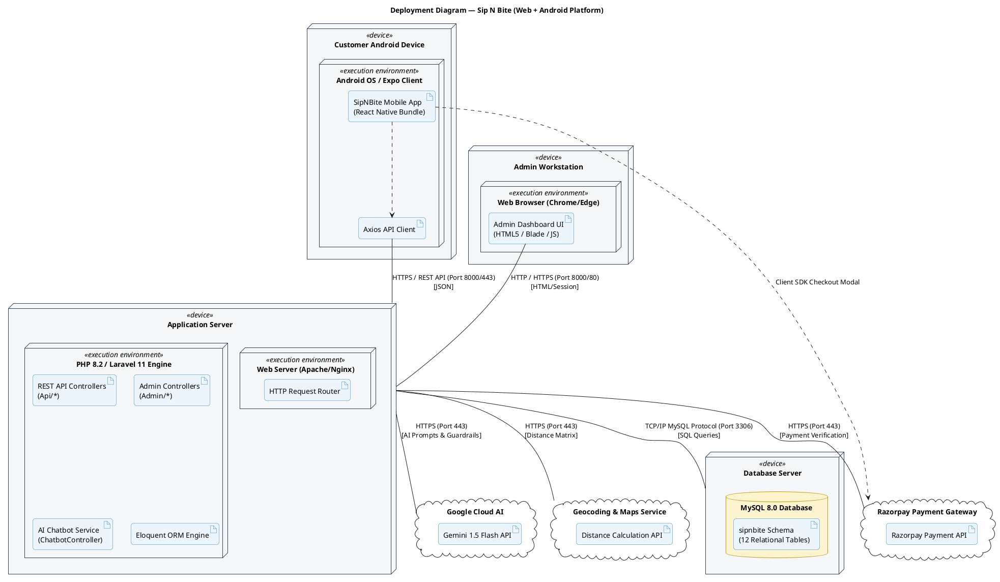

# 🚀 Deployment Diagram — Sip N Bite (Web + Android)

> **Project:** Sip N Bite — Smart Café & Food Ordering Platform  
> **Platform Scope:** Web Admin Dashboard (Laravel) + Mobile Application (React Native / Android) + Cloud Services  
> **Location:** `Documentation/diagrams_file_code/deployment_diagram.md`

---

## 1. Overview & Diagram Catalog

A **Deployment Diagram** models the physical hardware and runtime architecture of an enterprise software application. It visualizes the nodes (hardware devices, execution environments, servers), the artifacts (binaries, packages, schemas, scripts) deployed on them, and the network communication links connecting the tiers.

This document contains:
1. **Architectural Deployment Topology** *(Mermaid deployment diagram representing Client, Server, Database, and Cloud tiers)*
2. **Detailed Deployment Diagram** *(Hardware nodes, execution environments, software artifacts, and protocol specifications)*
3. **Node & Artifact Specification Matrix** *(Exact files, ports, runtimes, and responsibilities)*
4. **Network & Communication Protocol Matrix** *(Ports, encryption, and payload formats)*
5. **PlantUML Source Code** *(Ready to compile into formal UML artifacts)*

---

## 2. UML Deployment Diagram (Mermaid)

The diagram below illustrates the physical topology spanning the mobile client, browser client, Laravel application server, MySQL database server, and third-party cloud integrations.

### Mermaid Diagram Code

```mermaid
flowchart TB
    %% Client Tier
    subgraph ClientTier ["🖥️ CLIENT TIER"]
        subgraph Node_Android ["«device»<br/><b>Android Smartphone / Tablet</b>"]
            subgraph Env_Android ["«execution environment»<br/>Android OS (API 26+) / Expo Runtime"]
                Art_APK["«artifact»<br/><b>SipNBite.apk</b><br/>(React Native App Bundle)"]
                Art_Axios["«artifact»<br/>Axios REST Client & AsyncStorage"]
            end
        end

        subgraph Node_AdminPC ["«device»<br/><b>Admin / Staff Workstation</b>"]
            subgraph Env_Browser ["«execution environment»<br/>Modern Web Browser (Chrome/Edge)"]
                Art_BladeUI["«artifact»<br/><b>Admin Dashboard Views</b><br/>(Blade Templates, HTML5, CSS3, JS)"]
            end
        end
    end

    %% Application Server Tier
    subgraph ServerTier ["🏢 APPLICATION SERVER TIER"]
        subgraph Node_AppServer ["«device»<br/><b>Web & Application Server (Host OS)</b>"]
            subgraph Env_WebServer ["«execution environment»<br/>Apache / Nginx Web Server (Port 80/8000)"]
                Art_Router["«artifact»<br/>HTTP Request Router & SSL Termination"]
            end
            
            subgraph Env_PHP ["«execution environment»<br/>PHP 8.2+ Runtime / Laravel 11 Framework"]
                Art_RestApi["«artifact»<br/><b>Laravel REST API Engine</b><br/>(routes/api.php, Api Controllers)"]
                Art_AdminApp["«artifact»<br/><b>Admin Web Controllers</b><br/>(routes/web.php, Admin Controllers)"]
                Art_Chatbot["«artifact»<br/><b>AI Chatbot Engine</b><br/>(ChatbotController & Fallback)"]
                Art_Eloquent["«artifact»<br/><b>Eloquent ORM</b><br/>(Models & Query Builder)"]
            end
        end
    end

    %% Database Server Tier
    subgraph DatabaseTier ["🗄️ DATABASE TIER"]
        subgraph Node_DBServer ["«device»<br/><b>Database Server Node</b>"]
            subgraph Env_MySQL ["«execution environment»<br/>MySQL 8.0+ Database Engine (Port 3306)"]
                Art_DBSchema[("«artifact»<br/><b>sipnbite</b> Database Schema<br/>• users, categories, menu_items<br/>• orders, order_items, payments<br/>• tables, table_bookings<br/>• addresses, feedback")]
            end
        end
    end

    %% External Services Tier
    subgraph CloudTier ["☁️ EXTERNAL SERVICES / CLOUD TIER"]
        subgraph Node_Razorpay ["«device»<br/><b>Razorpay Cloud Gateway</b>"]
            Art_RazorpayAPI["«artifact»<br/>Razorpay Payment & Webhook API"]
        end

        subgraph Node_Gemini ["«device»<br/><b>Google Cloud AI Platform</b>"]
            Art_GeminiAPI["«artifact»<br/>Gemini 1.5 Flash REST API"]
        end

        subgraph Node_Geo ["«device»<br/><b>OpenStreetMap / Geocoding API</b>"]
            Art_GeoAPI["«artifact»<br/>Distance Matrix & Routing API"]
        end
    end

    %% Network Connections
    Node_Android -->|HTTPS / REST API (Port 8000/443)<br/>JSON Payloads| Node_AppServer
    Node_AdminPC -->|HTTPS / HTTP (Port 8000/80)<br/>HTML5 / Web Sessions| Node_AppServer
    
    Node_AppServer -->|TCP/IP Protocol (Port 3306)<br/>MySQL Native Connection| Node_DBServer
    
    Node_AppServer -->|HTTPS / TLS 1.3 (Port 443)<br/>cURL REST Request| Node_Gemini
    Node_AppServer -->|HTTPS / TLS 1.3 (Port 443)<br/>Payment Verification & Webhooks| Node_Razorpay
    Node_Android -->|HTTPS / TLS 1.3 (Port 443)<br/>Razorpay Checkout Modal| Node_Razorpay
    Node_AppServer -->|HTTPS (Port 443)<br/>Geocode & Distance Calculation| Node_Geo

    %% Styling
    classDef clientStyle fill:#e1f5fe,stroke:#0288d1,stroke-width:2px;
    classDef serverStyle fill:#e8f5e9,stroke:#388e3c,stroke-width:2px;
    classDef dbStyle fill:#fff3e0,stroke:#f57c00,stroke-width:2px;
    classDef cloudStyle fill:#f3e5f5,stroke:#7b1fa2,stroke-width:2px;

    class Node_Android,Node_AdminPC clientStyle;
    class Node_AppServer serverStyle;
    class Node_DBServer dbStyle;
    class Node_Razorpay,Node_Gemini,Node_Geo cloudStyle;
```

---

## 3. Node & Artifact Specification Matrix

| Node Name | Node Type | Execution Environment | Deployed Artifacts | Role & Responsibility |
|-----------|-----------|-----------------------|--------------------|-----------------------|
| **Android Smartphone** | Client Hardware Device | Android OS (v8.0+ / API 26+), React Native (Expo Go / Standalone APK) | `SipNBite.apk`, JavaScript Bundle (`App.jsx`), Axios HTTP Client, AsyncStorage | Customer-facing mobile application for browsing dishes, managing cart, booking tables, tracking orders, and AI chat. |
| **Admin PC / Laptop** | Client Hardware Device | Modern Web Browser (Google Chrome, Microsoft Edge, Mozilla Firefox) | Admin Blade UI, CSS styles, JavaScript dashboards, Chart.js graphs | Administrative interface for restaurant manager to update menu, categories, accept orders, and print invoices. |
| **Application Server** | Server Node (Localhost / Production Host) | Apache / Nginx Web Server, PHP 8.2+ CLI & FPM, Laravel 11 Framework | `routes/api.php`, `routes/web.php`, `app/Http/Controllers/*`, `app/Models/*`, Sanctum Middleware | Central business logic processor; routes requests, computes bill taxes, invokes Gemini AI, and manages transactions. |
| **Database Server** | Database Node | MySQL 8.0+ RDBMS Engine (listening on TCP port `3306`) | `sipnbite.sql` schema with 12 core tables: `users`, `categories`, `menu_items`, `orders`, `order_items`, `payments`, etc. | Persistent storage for users, food catalog, order histories, table bookings, customer addresses, and feedback. |
| **Razorpay Gateway** | External Cloud Service | High-availability cloud payment infrastructure | Razorpay Order API, Signature Verification SDK, Webhook Listener | Securely handles credit/debit card, UPI, and net-banking transactions; verifies tamper-proof cryptographic signatures. |
| **Google Gemini Cloud** | External Cloud Service | Google Cloud AI Infrastructure | `gemini-1.5-flash` LLM API endpoint | Natural language restaurant concierge; suggests dishes, answers dietary questions, grounded strictly on café menu data. |
| **Geocoding Service** | External Cloud Service | OpenStreetMap Nominatim / Distance Matrix | REST Geolocation endpoints | Computes road delivery distance from café coordinates to user's saved address to calculate dynamic delivery fee. |

---

## 4. Network & Communication Protocol Matrix

```
[Android Mobile App] ──(HTTPS/REST:8000)──┐
                                          ▼
                                 [Laravel Web Server] ──(TCP/3306)──► [MySQL DB]
                                          │
[Admin Web Browser] ──(HTTP/HTML:8000)────┤
                                          ├──(HTTPS/443)──► [Google Gemini AI]
                                          ├──(HTTPS/443)──► [Razorpay Cloud]
                                          └──(HTTPS/443)──► [Distance Matrix API]
```

| Source Node | Destination Node | Protocol / Port | Data Format | Security / Authentication | Purpose |
|-------------|------------------|-----------------|-------------|---------------------------|---------|
| Android App | Laravel Server | HTTP / HTTPS (Port 8000/443) | JSON | Bearer Tokens (Laravel Sanctum) | REST API requests (Catalog, Cart, Orders, Bookings, Chat). |
| Admin Browser | Laravel Server | HTTP / HTTPS (Port 8000/80) | HTML5 / CSS / JSON | Session Cookies & CSRF Tokens | Administrative management of restaurant operations and invoice generation. |
| Laravel Server | MySQL Database | TCP/IP (Port 3306) | Binary MySQL Protocol | Database User Credentials & SSL | Eloquent ORM queries for CRUD persistence. |
| Laravel Server | Razorpay Gateway | HTTPS (Port 443) | JSON | API Key ID + Secret Key Basic Auth | Initiating payment orders, capturing payments, verifying signatures. |
| Laravel Server | Google Gemini Cloud | HTTPS (Port 443) | JSON | `x-goog-api-key` Header | Conversational AI responses using the `gemini-1.5-flash` model. |
| Laravel Server | Geocoding API | HTTPS (Port 443) | JSON | API Query String Params | Calculating delivery distance between café and customer coordinates. |

---

## 5. PlantUML Source Code

You can compile this code using PlantUML tools to generate standard UML deployment diagrams:


