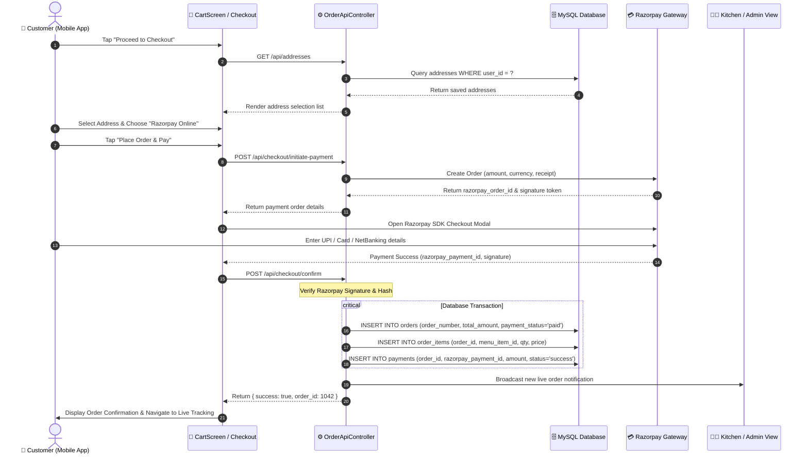
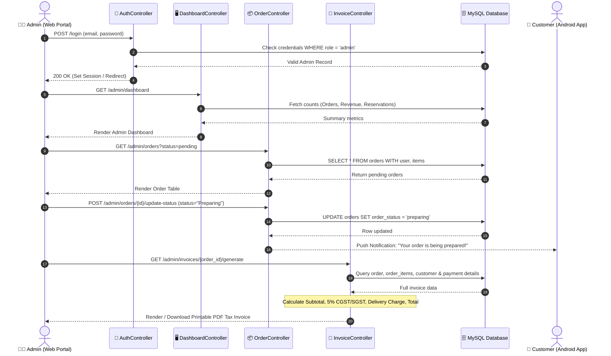
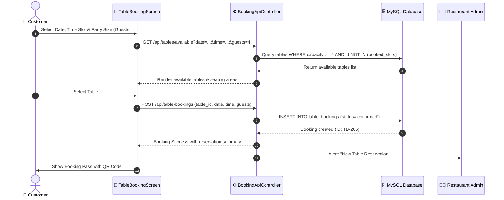
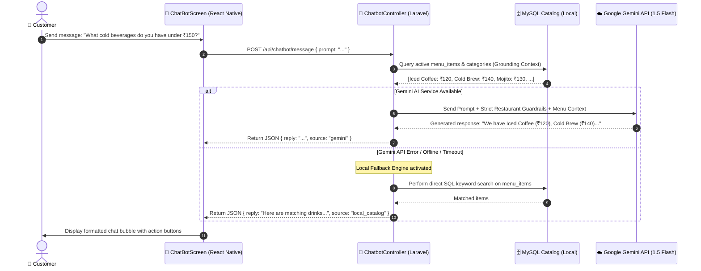
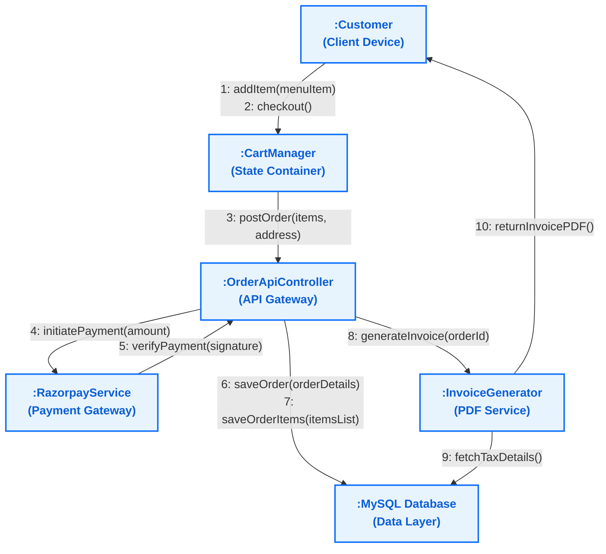
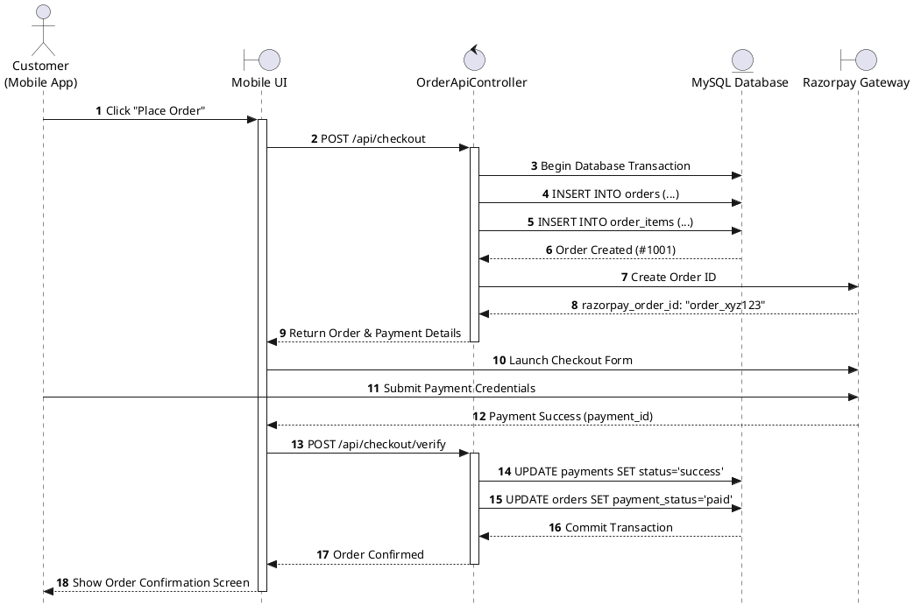
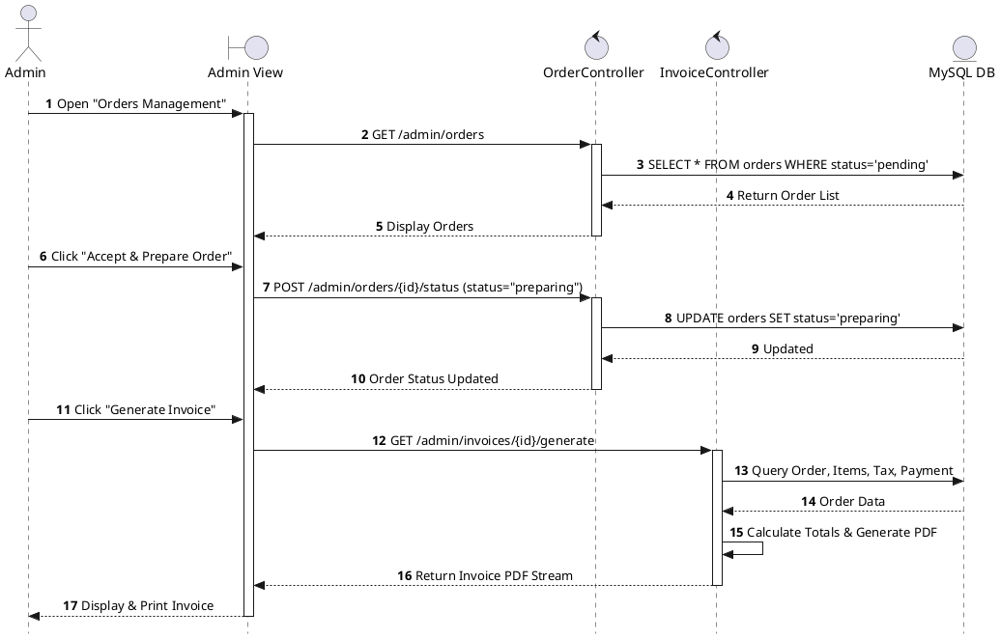

# 🔄 Interaction Diagram — Sip N Bite (Web + Android)

> **Project:** Sip N Bite — Smart Café & Food Ordering Platform  
> **Platform Scope:** Web Admin Dashboard + Mobile Application (React Native / Android) + REST APIs + External Gateways  
> **Location:** `Documentation/diagrams_file_code/interaction_diagram.md`

---

## 1. Overview & Diagram Catalog

**Interaction Diagrams** model the dynamic behavioral aspects of a software system by depicting how objects collaborate and communicate via message exchanges across time.

This document contains:
1. **Sequence Diagram 1: Customer Food Ordering & Online Payment Flow** *(Android Mobile App ↔ Laravel REST API ↔ Razorpay ↔ MySQL)*
2. **Sequence Diagram 2: Admin Order Management & Invoice Generation Flow** *(Admin Web ↔ Controllers ↔ Invoice PDF Generator)*
3. **Sequence Diagram 3: Dining Table Reservation Flow** *(Android / Web ↔ Booking API ↔ Table Availability Verification)*
4. **Sequence Diagram 4: AI Café Assistant Conversation Flow** *(Mobile App ↔ ChatbotController ↔ Gemini 1.5 Flash ↔ Offline DB Fallback)*
5. **Collaboration / Communication Diagram** *(Object structural communication view with message sequences)*
6. **PlantUML Source Codes** *(Full vector UML scripts)*

---

## 2. Sequence Diagram 1: Customer Food Ordering & Online Payment Flow

Depicts an end-to-end food ordering sequence initiated from the React Native Android application, interacting with Laravel's `OrderApiController`, processing payment with Razorpay, and saving records to MySQL.

### Mermaid Sequence Diagram

---

## 3. Sequence Diagram 2: Admin Order Management & Invoice Generation Flow

Directly aligns with the user's reference diagram workflow: Admin logs into the Web Dashboard, reviews incoming orders, updates dispatch status, and generates the customer invoice.

### Mermaid Sequence Diagram

---

## 4. Sequence Diagram 3: Dining Table Reservation Flow

Illustrates table booking from the mobile app, verification of available slots, and admin confirmation.

### Mermaid Sequence Diagram

---

## 5. Sequence Diagram 4: AI Café Assistant Interaction Flow

Details how customer messages are processed by Google Gemini 1.5 Flash API with strict restaurant grounding and resilient fallback to the local MySQL database.

### Mermaid Sequence Diagram

---

## 6. Collaboration / Communication Diagram

A **Collaboration Diagram** highlights the architectural topology and numbered message exchanges between collaborating objects.

---

## 7. PlantUML Source Code

### PlantUML Code for Customer Order & Payment Interaction

### PlantUML Code for Admin Order & Invoice Interaction

