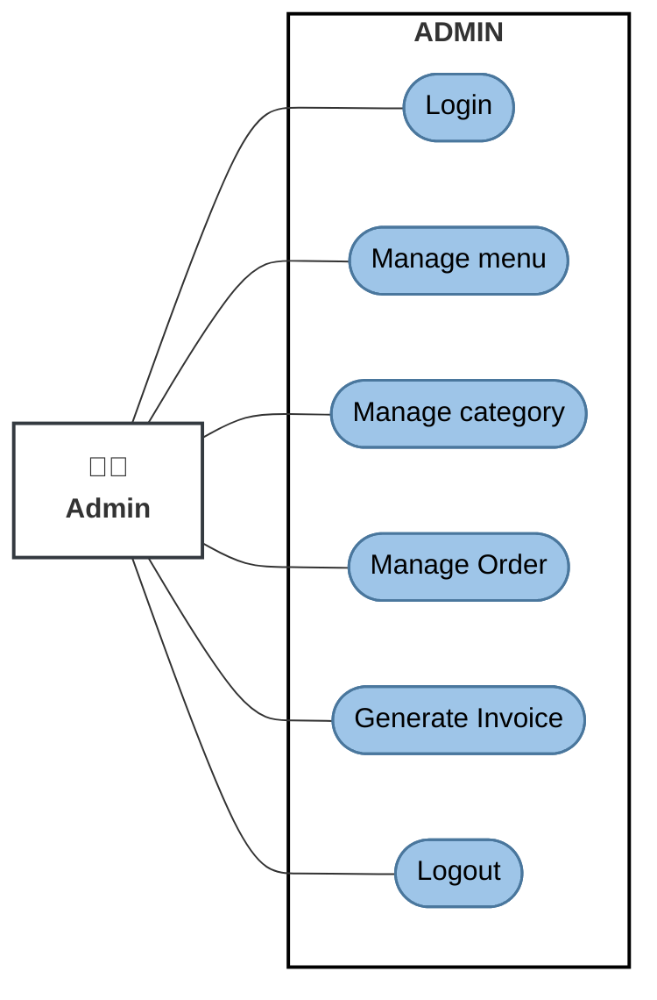
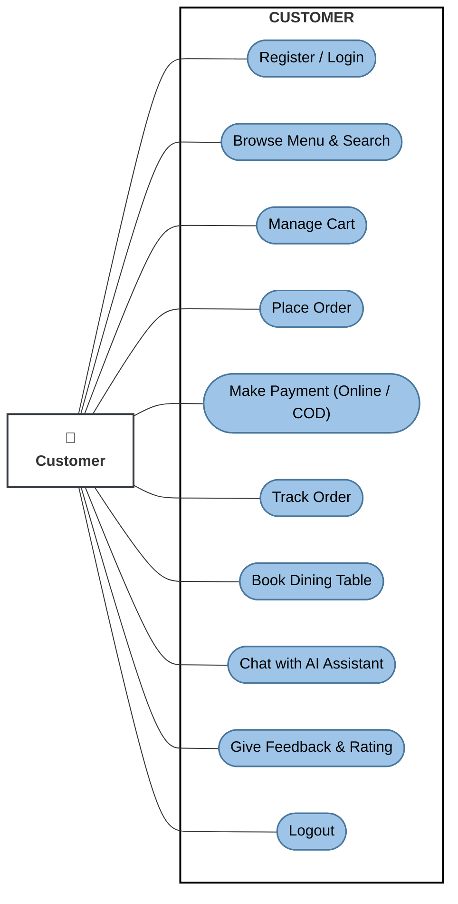
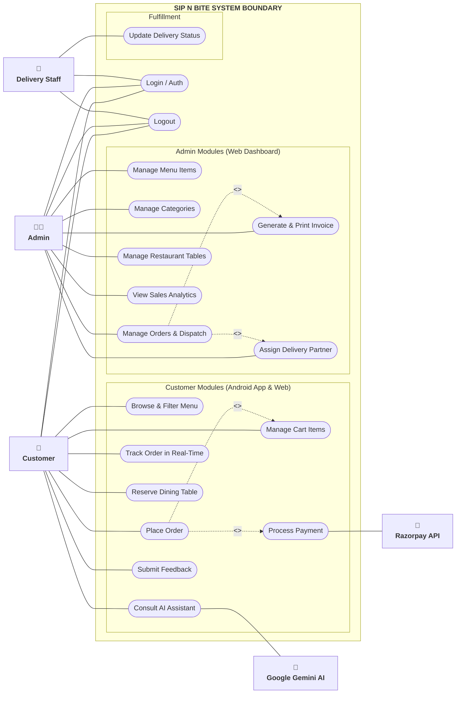
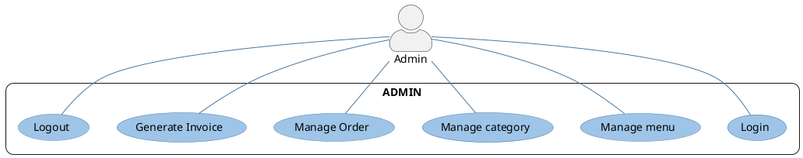
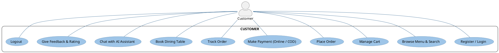
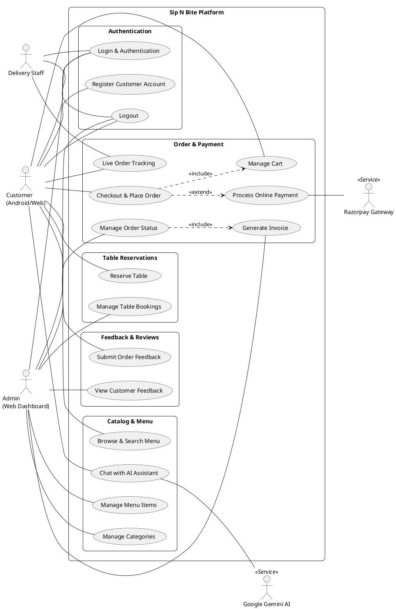

# 📌 Use Case Diagram — Sip N Bite (Web + Android)

> **Project:** Sip N Bite — Smart Café & Food Ordering Platform  
> **Platform Scope:** Web Admin Dashboard (Laravel 11) + Mobile Application (React Native / Android) + Web Customer Portal  
> **Location:** `Documentation/diagrams_file_code/use_case_diagram.md`

---

## 1. Executive Summary & Diagram Structure

This document provides dedicated, complete Use Case Diagrams for **both Admin and Customer**, formatted to match the exact visual style in the project specification and reference images.

- **Part 1:** **Admin Use Case Diagram** *(Matches Reference Image 1:1)*
- **Part 2:** **Customer Use Case Diagram** *(Formatted in the exact same reference style for Android / Web Customer)*
- **Part 3:** **Unified System Use Case Diagram** *(Admin + Customer + Delivery Staff + Payment Gateway + AI)*
- **Part 4:** **Complete PlantUML Source Codes** *(Ready for high-res export into project report docs)*

---

## 2. Admin Use Case Diagram (Exact Reference Style)

The diagram below corresponds 1:1 to the user's reference image:
- **Actor:** `Admin` (Left stick figure)
- **System Boundary:** `ADMIN`
- **Use Cases:**
  1. `Login`
  2. `Manage menu`
  3. `Manage category`
  4. `Manage Order`
  5. `Generate Invoice`
  6. `Logout`

### Mermaid Diagram (Admin)

---

## 3. Customer Use Case Diagram (Exact Reference Style)

Formulated in the exact same style as the Admin diagram to reflect the customer experience on the **React Native Android mobile app** and **Web customer portal**:
- **Actor:** `Customer` (Left stick figure)
- **System Boundary:** `CUSTOMER`
- **Use Cases:**
  1. `Register / Login`
  2. `Browse Menu & Search`
  3. `Manage Cart`
  4. `Place Order`
  5. `Make Payment (Online / COD)`
  6. `Track Order`
  7. `Book Dining Table`
  8. `Chat with AI Assistant`
  9. `Give Feedback & Rating`
  10. `Logout`

### Mermaid Diagram (Customer)

---

## 4. Comprehensive Unified System Use Case Diagram (Admin + Customer + Cloud)

Integrates both primary user roles (`Admin` and `Customer`), secondary actors (`Delivery Staff`, `Razorpay Gateway`, `Gemini AI`), and relational dependencies (`<<include>>` and `<<extend>>`).

### Mermaid Diagram (Unified System)

---

## 5. Use Case Specification Table (Admin vs. Customer)

| Actor | Use Case Name | Action Flow | Output / Result |
|-------|---------------|-------------|-----------------|
| **Admin** | **Login** | Enters admin credentials on `/login`. | Redirected to `/admin/dashboard` upon verification. |
| **Admin** | **Manage menu** | Creates, modifies prices, flags veg/non-veg, toggles availability. | Real-time update in `menu_items` table. |
| **Admin** | **Manage category** | Adds or updates categories (e.g., Pizza, Burgers, Fries, Drinks). | Categorization refreshed across Web and Mobile. |
| **Admin** | **Manage Order** | Reviews new incoming orders, changes status (`Pending` ➔ `Preparing` ➔ `Out for Delivery`). | Real-time push notification sent to customer. |
| **Admin** | **Generate Invoice** | Generates official tax invoice with GST calculation. | Printable invoice generated & stored. |
| **Admin** | **Logout** | Clicks logout button. | Session destroyed, redirected to login. |
| **Customer** | **Register / Login** | Signs up with name, email, phone, and password on mobile app. | Bearer token / session created. |
| **Customer** | **Browse Menu & Search**| Views categorized dishes with price, veg badge, and search filter. | Real-time catalog rendered via REST API. |
| **Customer** | **Manage Cart** | Adds dish, increments/decrements quantity, calculates live subtotal. | In-memory & stored cart state updated. |
| **Customer** | **Place Order** | Selects address, chooses payment mode (COD / Razorpay), confirms checkout. | New record created in `orders` and `order_items`. |
| **Customer** | **Make Payment** | Opens Razorpay modal or selects Cash on Delivery. | Transaction verified and saved in `payments`. |
| **Customer** | **Track Order** | Views live order status step-by-step from kitchen to delivery. | Visual progress bar updated in real-time. |
| **Customer** | **Book Dining Table** | Selects date, time slot, and guest count to reserve table. | Entry stored in `table_bookings` table. |
| **Customer** | **Chat with AI** | Interacts with AI assistant for recommendations & dish details. | Response generated by Gemini 1.5 Flash. |
| **Customer** | **Give Feedback** | Rates completed order from 1 to 5 stars with comment. | Feedback recorded in `feedback` table. |
| **Customer** | **Logout** | Signs out of the mobile app or web portal. | Auth token cleared from device storage. |

---

## 6. PlantUML Source Code

### 6.1 PlantUML Code — Admin Use Case Diagram (Exact Reference Match)

### 6.2 PlantUML Code — Customer Use Case Diagram (Exact Reference Style)

### 6.3 PlantUML Code — Unified System Use Case Diagram

